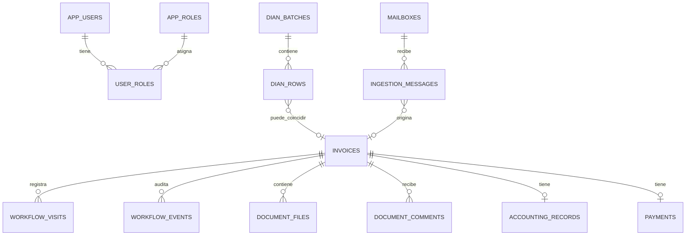

# Gestión de facturas — modelo de datos para TI

## 1. Propósito

Este documento acompaña el código del aplicativo de gestión documental de facturas. Describe la estructura recomendada para llevar el demo a una instalación empresarial con trazabilidad completa desde la recepción del correo hasta el archivo posterior al pago.

La solución debe conservar una sola ficha por documento y registrar cada permanencia en una bandeja como un registro independiente. De esta manera es posible responder, sin promedios ni tiempos objetivo:

- ¿Dónde está actualmente el documento?
- ¿Qué usuario lo tiene asignado?
- ¿Desde cuándo está allí?
- ¿Cuánto tiempo permaneció en cada bandeja anterior?
- ¿Quién lo devolvió, por qué motivo y hacia dónde?

## 2. Decisión tecnológica

El demo vigente utiliza Next.js/Vinext, Drizzle ORM, Cloudflare D1 (SQLite) y R2 para los archivos. En el código actual existen estas tablas de persistencia inicial:

| Tabla actual | Uso |
|---|---|
| `invoice_records` | Datos principales de la factura y su bandeja actual |
| `invoice_files` | PDF, XML y soportes almacenados en R2 |
| `ingestion_messages` | Idempotencia y resultado de la lectura del buzón |

Para operación empresarial se recomienda implementar el modelo completo de este documento en PostgreSQL administrado o en la base de datos corporativa. El archivo `schema-postgresql.sql` contiene una referencia ejecutable para PostgreSQL 15 o superior. Si TI decide conservar D1/SQLite, las mismas entidades pueden llevarse a Drizzle con ajustes de tipos (`uuid` por `text`, `timestamptz` por `text` y `numeric` por `integer/real`).

## 3. Relación general

## 4. Tablas principales

### Catálogos y seguridad

- `app_users`: personas que interactúan con el aplicativo.
- `app_roles`: Radicador, Aprobador, Contabilidad, Rechazos DIAN manuales, Tesorería, Legalizaciones y Administrador.
- `user_roles`: relación muchos a muchos entre usuarios y roles.
- `areas`: TIC, Compras, Contabilidad, Gestión documental, Tesorería, etc.
- `cost_centers`: opciones seleccionables por el Aprobador.
- `mailboxes`: buzones configurados para recepción.

### Documento y archivos

- `invoices`: ficha única del documento, CUFE/CUDE, proveedor, valor, vencimiento, NIT receptor, bandeja y asignación actual.
- `document_files`: PDF, XML, soportes, certificados de rechazo, documentos de causación y comprobantes de pago. El archivo físico vive en R2, S3, Azure Blob o el gestor corporativo; la base guarda metadatos y la ruta segura.
- `document_comments`: comentarios opcionales realizados por cualquier rol autorizado.
- `invoice_relations`: relación de notas crédito o débito con la factura original.

### Trazabilidad

- `workflow_visits`: una fila por permanencia en Radicación, Aprobación, Contabilidad, Tesorería, Rechazos o Legalizaciones. Al salir de la bandeja se cierra con `ended_at` y `duration_seconds`.
- `workflow_events`: acciones ejecutadas y auditoría del movimiento. Incluye motivo y categoría cuando se devuelve o se envía a rechazo.
- `audit_log`: cambios sensibles de seguridad, configuración y administración.

### Procesos especiales

- `accounting_records`: documento de causación diligenciado por Contabilidad.
- `payments`: fecha, referencia y usuario que registra el pago. El comprobante se guarda como `document_files` con tipo `PAYMENT_PROOF`.
- `legalizations`: documento de legalización para soportes pagados de contado que no generan CxP.
- `rejection_cases`: gestión manual ante DIAN, certificado adjunto y archivo posterior.
- `ingestion_messages`: control de mensajes y adjuntos procesados para no duplicar facturas.
- `dian_batches`: archivo mensual cargado desde DIAN.
- `dian_rows`: filas del listado DIAN, resultado de conciliación y eventual factura radicada por CUFE.
- `dian_xml_requests`: trazabilidad de la solicitud de XML por CUFE cuando se active el conector oficial DIAN.

## 5. Reglas funcionales que debe aplicar la base o el servicio

1. El NIT receptor se guarda normalizado, sin puntos ni dígito de verificación, y debe ser `901373083` para radicar.
2. Un CUFE/CUDE no puede crear dos fichas de factura.
3. La combinación proveedor + prefijo + folio debe controlar duplicados cuando todavía no exista CUFE.
4. Cada cambio de bandeja debe cerrar la permanencia abierta y crear una nueva. No se deben sobrescribir los tiempos históricos.
5. El documento de causación es un campo de Contabilidad; enviar a Tesorería no significa crear automáticamente la causación.
6. Tesorería permanece responsable hasta que registre el comprobante de pago y cierre el expediente.
7. La devolución exige categoría y comentario. El rechazo manual exige motivo y certificado antes de archivar.
8. El PDF y el XML deben permanecer descargables según permisos; el PDF puede mostrarse en línea.
9. Un archivo recibido debe identificarse por `message_id + attachment_id` para evitar reprocesamiento.
10. Los secretos de Microsoft Graph, DIAN y almacenamiento no deben estar en el repositorio; deben vivir en el administrador de secretos o variables protegidas del entorno.

## 6. Flujo de tiempos

Al crear la ficha se inserta una fila en `workflow_visits` para Radicación. Ejemplo de movimiento:

1. Se cierra la visita de Radicación con `ended_at` y duración.
2. Se registra un `workflow_event` con acción `ASSIGN_TO_APPROVER`.
3. Se crea una visita abierta para Aprobación con el usuario elegido.
4. Al devolver o avanzar se repite el patrón.

La bandeja de consulta calcula el tiempo actual con `COALESCE(duration_seconds, NOW() - started_at)` y muestra la última visita abierta. El historial muestra todas las visitas cerradas, incluso si el documento fue devuelto y pasó nuevamente por la misma bandeja.

## 7. Índices mínimos

El DDL crea índices para CUFE/CUDE, bandeja actual, responsable, vencimiento, proveedor, fechas de recepción y eventos. Para búsquedas de texto de alto volumen, TI puede agregar un índice full-text o Elasticsearch/OpenSearch; no es necesario para el demo.

## 8. Migración desde el demo

1. Mantener `invoice_records`, `invoice_files` e `ingestion_messages` durante la transición.
2. Migrar cada fila de `invoice_records` a `invoices`.
3. Migrar cada `invoice_files` a `document_files`, conservando `object_key`.
4. Crear una visita inicial en `workflow_visits` usando `received_at` como `started_at` y el rol/responsable actual.
5. Migrar `history` a `workflow_events` con una acción de tipo `SYSTEM_NOTE` o conservarlo como respaldo temporal.
6. Activar la escritura transaccional: movimiento, visita y evento deben confirmarse juntos.
7. Validar duplicados por CUFE y por proveedor + prefijo + folio antes de retirar el esquema inicial.

## 9. Entornos

- **Desarrollo:** base aislada y almacenamiento de pruebas; nunca usar el buzón productivo.
- **Pruebas/UAT:** datos anonimizados, usuarios de prueba y buzón de ensayo.
- **Producción:** Microsoft Graph con consentimiento de administrador Entra, almacenamiento privado, backups, auditoría y permisos por rol.

